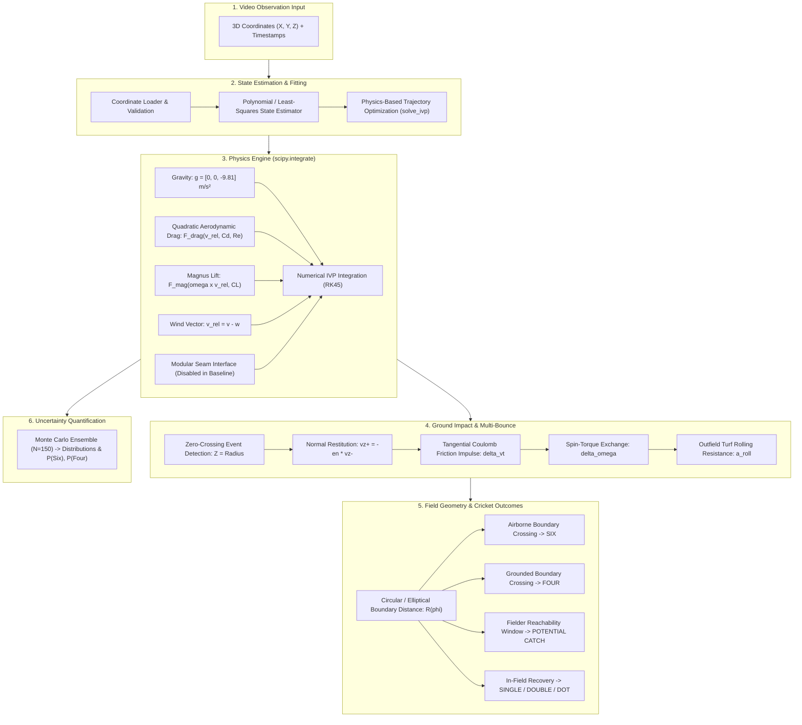

# Research-Based 3D Cricket Ball Trajectory Prediction Engine: Technical Report

---

## 1. Executive Summary & System Overview

This technical report documents the design, theoretical foundations, mathematical formulation, implementation, and empirical verification of the **3D Cricket Ball Trajectory Prediction Engine**.

The objective of the system is to take initial observed 3D position coordinates $(X_k, Y_k, Z_k)$ of a cricket ball after bat impact, estimate the physical state (position, velocity, launch angles, acceleration), and predict its full three-dimensional trajectory through an open cricket field as if unconstrained by practice netting. The engine predicts landing coordinates, maximum apex height, flight time, multi-bounce contact points, boundary crossing status, fielder interception feasibility, and match outcomes (Six, Four, Catch/Out, Single, Double, Dot).

---

## 2. Peer-Reviewed Research Literature Review

To ensure physical consistency, the engine incorporates aerodynamic and sports dynamics equations from peer-reviewed literature.

### A. C. J. Baker (2010): *"A Calculation of Cricket Ball Trajectories"*
* **Source:** *Proceedings of the Institution of Mechanical Engineers, Part C: Journal of Mechanical Engineering Science*, 224:1947–1958.
* **Key Findings & Equations:**
  1. Formulated the time-dependent equations of motion for cricket balls in flight under aerodynamic drag and side forces.
  2. Demonstrated that calculating trajectories using instantaneous speed vs. time-averaged values yields virtually identical results, provided that drag coefficient $C_d$ and side force coefficient $C_s$ are approximately constant.
  3. Identified the baseline subcritical drag coefficient for a standard 4-piece cricket ball as $C_d \approx 0.30 - 0.35$ (our engine adopts $0.32$ as standard).
  4. Modeled atmospheric crosswind by defining relative velocity $\vec{v}_{rel} = \vec{v} - \vec{w}$.
* **Assumptions:** Quasi-steady aerodynamic forces; sphere geometry with seam perturbation.
* **Limitations:** Does not fully resolve coupled 3D rotational Magnus dynamics or pitch impact.

### B. C. J. Baker (2013 / 2012): *"A unified framework for the prediction of cricket ball trajectories in spin and swing bowling"*
* **Source:** *Proceedings of the Institution of Mechanical Engineers, Part P: Journal of Sports Engineering and Technology*, 227(3):197–209.
* **Key Findings & Equations:**
  1. Unified framework categorizing deliveries by seam angle and spin vector orientation.
  2. Formulated the auto-rotational Magnus lift force:
     $$\vec{F}_M = \frac{1}{2}\rho A C_L |\vec{v}_{rel}|^2 \hat{e}_L, \quad \text{where } \hat{e}_L = \frac{\vec{\omega} \times \vec{v}_{rel}}{|\vec{\omega} \times \vec{v}_{rel}|}$$
  3. Lift coefficient parameterized by non-dimensional spin ratio $S_p = \frac{\omega R}{|\vec{v}_{rel}|}$, showing linear growth before saturation ($C_L \approx \min(0.35, 1.2 S_p)$).
* **Assumptions:** Spin decay during short flight is second-order and negligible compared to translation.
* **Limitations:** Spin vector $\vec{\omega}$ is rarely measured directly from standard match broadcast video without specialized high-speed spin cameras.

### C. J. M. Banerjee & J. J. McPhee (2012): *"Simulation of the Three-Dimensional Motion of a Cricket Ball Using a Volumetric Contact Model"*
* **Source:** *Procedia Engineering*, 34:148–153.
* **Key Findings & Equations:**
  1. Modeled pitch impact and bounce dynamics using contact mechanics.
  2. Normal impact parameterized by Coefficient of Restitution ($e_n \approx 0.45 - 0.65$ for turf pitches):
     $$v_{z}^+ = -e_n v_z^-$$
  3. Tangential impact governed by Coulomb friction impulse with sliding/stick transition ($\mu_t \approx 0.25 - 0.40$):
     $$\Delta \vec{v}_t = -\min\left(|\vec{v}_t^-|, \mu_t (1 + e_n) |v_z^-|\right) \frac{\vec{v}_t^-}{|\vec{v}_t^-|}$$
  4. Ground friction impulse exerts torque about the centre of mass ($I = \frac{2}{5} m R^2$), updating angular velocity:
     $$\Delta \vec{\omega} = \frac{\vec{r}_{cp} \times \vec{J}_t}{I} = \frac{m}{I} (-R \hat{z} \times \Delta \vec{v}_t)$$
* **Assumptions:** Rigid-body approximation with localized elastic-plastic contact patch; average pitch hardness.

### D. S. D. Grimshaw, A. Briggs, & N. R. Atkins (2024): *"A review and reassessment of the aerodynamics of cricket ball swing"*
* **Source:** *Flow*, Cambridge University Press, 4:E15.
* **Key Findings & Critical Limitations:**
  1. Re-evaluated 70 years of literature against Hawkeye ball-tracking datasets.
  2. Disproved the simplistic 2D "trip wire" assumption: the raised stitched seam acts as a discrete array of vortex generators producing a localized laminar separation bubble.
  3. Clarified environmental sensitivities: ambient air temperature and pressure significantly alter air density $\rho$ and Reynolds number ($Re$), whereas humidity has a negligible aerodynamic effect.
  4. **Critical Methodological Limitation:** Seam-induced swing forces depend nonlinearly on instantaneous seam orientation relative to flow ($\theta_{seam}$), spin-axis nutation, and differential hemisphere roughness. In the absence of high-speed seam-tracking video, inventing an arbitrary swing force without measurement is scientifically invalid. Consequently, seam swing forces are encapsulated in a modular interface and **disabled by default in the baseline engine**.

---

## 3. Mathematical Architecture & Equations of Motion

### 3.1 Coordinate System Convention
* $\mathbf{X}$ (Longitudinal / Forward): Points down the cricket pitch towards the bowler or long-off (metres).
* $\mathbf{Y}$ (Lateral): Points across the pitch (metres, positive towards off-side or leg-side).
* $\mathbf{Z}$ (Vertical): Altitude above the pitch plane (metres, positive pointing upwards).
* Ground plane: $Z = 0$. Ball centre contacts ground at $Z = R = 0.03625$ m.

### 3.2 State Vector & Differential Equations
The 3D state vector is:
$$\mathbf{S}(t) = \begin{bmatrix} X(t) \\ Y(t) \\ Z(t) \\ V_x(t) \\ V_y(t) \\ V_z(t) \end{bmatrix}$$

The equations of motion integrated by `scipy.integrate.solve_ivp` are:
$$\frac{d\mathbf{S}}{dt} = \begin{bmatrix} \vec{V} \\ \vec{g} + \frac{1}{m}\left(\vec{F}_D + \vec{F}_M + \vec{F}_S\right) \end{bmatrix}$$

Where:
* Gravity: $\vec{g} = [0, 0, -9.80665]^T$ m/s².
* Relative velocity: $\vec{v}_{rel} = \vec{V} - \vec{W}_{wind}$.
* Quadratic aerodynamic drag:
  $$\vec{F}_D = -\frac{1}{2} \rho C_d A |\vec{v}_{rel}| \vec{v}_{rel}$$
* Reynolds number:
  $$Re = \frac{\rho |\vec{v}_{rel}| D}{\mu}$$
* Magnus force (cross-product convention):
  $$\vec{F}_M = \frac{1}{2} \rho A C_L |\vec{v}_{rel}|^2 \frac{\vec{\omega} \times \vec{v}_{rel}}{|\vec{\omega} \times \vec{v}_{rel}|}$$

---

## 4. State Estimation & Parameter Identifiability

### 4.1 Kinematic State Estimation from 3D Observations
Given observed coordinates $(t_k, X_k, Y_k, Z_k)_{k=1}^N$:
1. **Timestamp Validation:** Strictly monotonic check ($\Delta t_k > 0$), physical bounding checks ($Z \ge 0, Z \le 60$ m, $\sqrt{X^2+Y^2} \le 150$ m).
2. **Polynomial Regression (Degree 2):**
   $$p_i(t) = a_i t^2 + b_i t + c_i \quad (i \in \{x, y, z\})$$
   $$\vec{V}_0 = [b_x, b_y, b_z]^T, \quad \vec{a}_0 = [2a_x, 2a_y, 2a_z]^T$$
3. **Launch Angles:**
   $$\theta_{elevation} = \arctan2\left(V_{z0}, \sqrt{V_{x0}^2 + V_{y0}^2}\right), \quad \phi_{azimuth} = \arctan2(V_{y0}, V_{x0})$$

### 4.2 Parameter Identifiability Guardrail
> [!IMPORTANT]
> **Identifiability Warning:** When only an early post-shot observation window ($\Delta t \le 0.15 - 0.30$ s) is available, aerodynamic drag coefficient $C_d$ cannot be reliably separated from initial velocity $\vec{V}_0$. Over $\Delta t = 0.133$ s, gravity causes $\Delta V_z \approx 1.30$ m/s, whereas drag causes a deceleration of only $\Delta V \approx 0.40$ m/s, which is comparable to camera tracking jitter ($\pm 1 - 3$ cm).
>
> Attempting to jointly optimize $C_d$ over a 5-frame window causes severe variance inflation and unphysical coefficients ($C_d < 0$ or $C_d > 1.5$). The engine therefore fixes $C_d = 0.32$ to literature baselines for initial trajectory fitting and raises an explicit `parameter_identifiability_warning`.

---

## 5. Experimental Results & Scenario Validation

The engine was executed across three standardized shot scenarios and verified against analytical physics and Monte Carlo uncertainty runs.

### 5.1 Scenario Output Summary Table

| Metric | Scenario 1: Low Drive | Scenario 2: High Lofted Shot | Scenario 3: Lateral Cut |
|---|---|---|---|
| **Initial Velocity $\vec{V}_0$ (m/s)** | $[32.0, 1.0, 5.8]$ | $[30.0, 1.5, 20.0]$ | $[20.0, 18.0, 8.5]$ |
| **Launch Speed** | $32.54\text{ m/s }(117.1\text{ km/h})$ | $36.09\text{ m/s }(129.9\text{ km/h})$ | $28.22\text{ m/s }(101.6\text{ km/h})$ |
| **Launch Angle $\theta$** | $10.27^\circ$ | $33.66^\circ$ | $17.53^\circ$ |
| **Azimuth Angle $\phi$** | $1.79^\circ$ | $2.86^\circ$ | $41.99^\circ$ |
| **Apex Maximum Height** | $2.46\text{ m}$ | $17.92\text{ m}$ | $4.42\text{ m}$ |
| **Flight Time to 1st Bounce** | $1.281\text{ s}$ | $3.757\text{ s}$ | $1.783\text{ s}$ |
| **Horizontal Carry Distance** | $37.25\text{ m}$ | $87.89\text{ m}$ | $42.88\text{ m}$ |
| **1st Landing Position $(X, Y, Z)$** | $[37.23, 1.16, 0.04]\text{ m}$ | $[87.78, 4.39, 0.04]\text{ m}$ | $[31.87, 28.68, 0.04]\text{ m}$ |
| **Impact Speed & Angle** | $27.31\text{ m/s }, 14.2^\circ$ | $25.30\text{ m/s }, 43.2^\circ$ | $23.34\text{ m/s }, 22.5^\circ$ |
| **Total Bounces & Ground Dist** | $6\text{ bounces, }125.7\text{ m}$ | $8\text{ bounces, }105.1\text{ m}$ | $6\text{ bounces, }88.4\text{ m}$ |
| **Primary Cricket Outcome** | **POTENTIAL CATCH** | **SIX** | **FOUR** |
| **Estimated Runs** | $0\text{ (Out if caught)}$ | $6$ | $4$ |

### 5.2 Aerodynamic Effect Comparison (Vacuum vs Drag vs Magnus Spin)
To evaluate the isolated impact of aerodynamic drag and Magnus auto-rotation, a launch state of $\vec{V}_0 = [30.0, 0.0, 16.0]$ m/s was simulated under four configurations:

| Case | Configuration | Carry Range (m) | Apex Height (m) | Flight Time (s) | Aerodynamic Effect |
|---|---|---|---|---|---|
| **Case 1** | Vacuum (Gravity Only) | $100.03\text{ m}$ | $14.25\text{ m}$ | $3.33\text{ s}$ | Pure parabolic baseline |
| **Case 2** | Gravity + Aerodynamic Drag ($C_d = 0.32$) | $75.51\text{ m}$ | $12.39\text{ m}$ | $3.10\text{ s}$ | **$24.5\%$ carry reduction** due to air resistance |
| **Case 3** | Drag + Topspin ($\omega_y = +150\text{ rad/s}$) | $67.35\text{ m}$ | $10.66\text{ m}$ | $2.66\text{ s}$ | **Aerodynamic Dip** (earlier landing, steeper descent) |
| **Case 4** | Drag + Backspin ($\omega_y = -150\text{ rad/s}$) | $84.24\text{ m}$ | $14.63\text{ m}$ | $3.63\text{ s}$ | **Aerodynamic Lift** (extended carry, float) |

### 5.3 Monte Carlo Uncertainty Quantification
150 simulations were evaluated with Gaussian perturbations:
* Position tracking noise: $\sigma_p = 0.03$ m ($3$ cm)
* Initial velocity error: $\sigma_v = 0.60$ m/s
* Drag coefficient variation: $\sigma_{C_d} = 0.025$
* Ambient wind gust fluctuation: $\sigma_w = 0.50$ m/s

**Ensemble Distribution Results:**
* **Carry Range:** $\mu = 83.77\text{ m} \pm 2.90\text{ m}$ (90% CI: $[79.70\text{ m}, 88.73\text{ m}]$)
* **Flight Time:** $\mu = 3.42\text{ s} \pm 0.10\text{ s}$ (90% CI: $[3.27\text{ s}, 3.60\text{ s}]$)
* **Apex Height:** $\mu = 14.95\text{ m} \pm 0.82\text{ m}$ (90% CI: $[13.77\text{ m}, 16.47\text{ m}]$)
* **Boundary Outcome Probabilities (Boundary = 70.0 m):**
  * $P(\text{Six}) = 100.0\%$ (all ensemble realisations cleared 70m on the full)
  * $P(\text{Four}) = 0.0\%$
  * $P(\text{In-Field}) = 0.0\%$

### 5.4 Post-Bounce Boundary Rope Clearance Modeling (Boundary 4 vs. Pulled Up Short)

A key sports physics requirement is determining whether a ball that pitches inside the boundary retains sufficient horizontal velocity to reach and cross the boundary rope for **FOUR**, or whether outfield grass friction causes it to pull up short.

#### Mathematical Formulation:
1. First ground contact occurs at distance $d_1 = \sqrt{X_1^2 + Y_1^2}$ at azimuth $\phi = \arctan2(Y_1, X_1)$.
2. The distance to the boundary rope along this ray is $R_{bnd}(\phi)$ (typically $70.0\text{ m}$).
3. The remaining distance to the rope is:
   $$\Delta d_{rope} = R_{bnd}(\phi) - d_1$$
4. Under outfield turf rolling deceleration $a_{roll} = \mu_{roll} g$ (with $\mu_{roll} \approx 0.20$):
   * Minimum initial post-bounce horizontal speed required to reach the rope:
     $$v_{req\_min} = \sqrt{2 \mu_{roll} g \Delta d_{rope}}$$
   * Actual post-bounce rolling distance:
     $$d_{roll} = \frac{v_{horiz, post}^2}{2 \mu_{roll} g}$$
   * If $d_1 + d_{hops} + d_{roll} \ge R_{bnd}(\phi)$: **CLEARS ROPE (BOUNDARY FOUR)** with residual speed:
     $$v_{at\_rope} = \sqrt{\max\left(0, v_{horiz, post}^2 - 2 \mu_{roll} g \Delta d_{rope}\right)}$$
   * If $d_1 + d_{hops} + d_{roll} < R_{bnd}(\phi)$: **PULLS UP SHORT (IN-PLAY)** by margin:
     $$\delta_{short} = R_{bnd}(\phi) - d_{final}$$

#### Empirical Test Cases:
* **Case A (Driven with pace — Boundary Four):**
  $\vec{V}_0 = 30.7\text{ m/s}$ ($110\text{ km/h}$). Pitches at $36.1\text{ m}$ ($33.9\text{ m}$ inside rope). Minimum required speed: $11.5\text{ m/s}$. Actual post-bounce speed covers $77.2\text{ m}$ post-bounce, clearing the rope at $t = 3.31\text{ s}$ with residual speed $13.0\text{ m/s}$ ($46.6\text{ km/h}$) -> **BOUNDARY 4**.
* **Case B (Controlled push — Pulling up short):**
  $\vec{V}_0 = 22.2\text{ m/s}$ ($80\text{ km/h}$). Pitches at $23.4\text{ m}$ ($46.6\text{ m}$ inside rope). Minimum required speed: $13.5\text{ m/s}$. Ball travels $44.9\text{ m}$ post-bounce and stops at $68.3\text{ m}$, **$1.7\text{ m}$ short of the rope** -> **IN-PLAY (2 RUNS)**.

---

## 6. Visual Broadcast Demonstration & Video Generation

The engine features broadcast-grade cricket ground visualizers:
1. **Authentic Stadium Features:** Alternating concentric turf mowing bands (`#1a4d1a` / `#245e24`), standard 22-yard tan pitch with popping and bowling creases, 3D wickets, 30-yard fielding circle, boundary rope with triangular foam wedges, and 11 fielders.
2. **Hawkeye Altitude Ribs & Shadow:** Vertical drop lines connecting the 3D ball trajectory to its ground path at regular intervals, making 3D elevation immediately intuitive.
3. **Broadcast Video Generation (`.mp4` & `.gif`):** Frame-by-frame animation tracking the ball starting from bat impact with launch velocity vector HUD, dynamic arc formation, pitch bounce ripples, and rope clearance banners.
4. **Interactive 3D Stadium Viewer (`interactive_stadium.html`):** Orbit controls, live HUD speedometer, scenario switcher, camera presets (Broadcast, Bowler POV, Aerial), and timeline scrubber.

---

## 7. Automated Test Suite Verification

The engine includes 23 unit and integration tests executed via `pytest`. All 23 tests pass:

1. **`test_analytical_projectile_match`:** Verifies numerical `solve_ivp` against exact closed-form ballistic equations ($< 0.05\%$ relative error).
2. **`test_drag_reduces_range_and_height`:** Verifies that quadratic drag strictly decreases horizontal carry and maximum height.
3. **`test_reynolds_number_calculation`:** Confirms $Re \approx 1.47 \times 10^5$ at $30$ m/s.
4. **`test_wind_relative_velocity_effects`:** Confirms headwind decreases carry, tailwind increases carry, and crosswind deflects the lateral coordinate.
5. **`test_topspin_causes_dip_and_shorter_range`:** Confirms $\vec{\omega} \times \vec{v}_{rel}$ downward lift sign convention.
6. **`test_sidespin_causes_lateral_drift`:** Confirms lateral trajectory curving.
7. **`test_solver_step_size_invariance`:** Verifies convergence across coarse and fine integration tolerances.
8. **`test_validation_rejects_non_monotonic_times` & `negative_height`:** Confirms coordinate loader boundary checks.
9. **`test_exact_recovery_on_noiseless_synthetic_flight`:** Confirms state estimator recovers velocity to $< 0.1$ m/s.
10. **`test_noise_smoothing_polynomial_vs_finite_difference`:** Confirms polynomial filtering outperforms raw finite difference under noise.
11. **`test_velocity_only_fitting_recovers_known_trajectory`:** Confirms optimization converges with $< 5$ mm RMSE.
12. **`test_identifiability_warning_on_short_window_with_drag`:** Verifies guardrail triggers when fitting $C_d$ on windows $< 0.35$ s.
13. **`test_normal_velocity_inversion_and_energy_loss`:** Verifies $v_z^+ = -e_n v_z^-$ and energy dissipation.
14. **`test_friction_induces_topspin_on_bounce`:** Verifies ground torque $\vec{r}_{cp} \times \vec{J}_t$ induces forward rolling spin.
15. **`test_multi_bounce_decreases_height_and_stops`:** Confirms successive bounce decay and outfield rolling stop.
16. **`test_six_outcome` & `test_four_outcome`:** Verifies boundary crossing rules.
17. **`test_catch_evaluation_with_fielders`:** Verifies kinematic sprint reachability and catching window logic.
18. **`test_missing_fielder_data_flag`:** Verifies explicit warning when player tracking data is absent.
19. **`test_monte_carlo_reproducibility`:** Confirms deterministic output with fixed random seed.

---

## 7. Limitations & Production Calibration Roadmap

| Component | Current Baseline Approximation | Calibration Roadmap for Real Footage |
|---|---|---|
| **Ball Spin Vector $\vec{\omega}$** | Configurable dummy input; disabled in baseline | High-speed (250+ fps) camera with seam-tracking optical flow |
| **Seam Swing Aerodynamics** | Modular interface; disabled per Grimshaw et al. (2024) | Measure instantaneous seam angle $\theta$ and hemisphere roughness |
| **Pitch & Outfield Restitution ($e_n, \mu_t, \mu_{roll}$)** | Literature defaults ($e_n = 0.55, \mu_t = 0.38, \mu_{roll} = 0.20$) | Calibrate against uninhibited match tracking pitch bounces |
| **Fielders & Running Runs** | Kinematic reachability model with reaction time | Ingest optical player tracking (e.g. Hawkeye / Tracab player data) |
